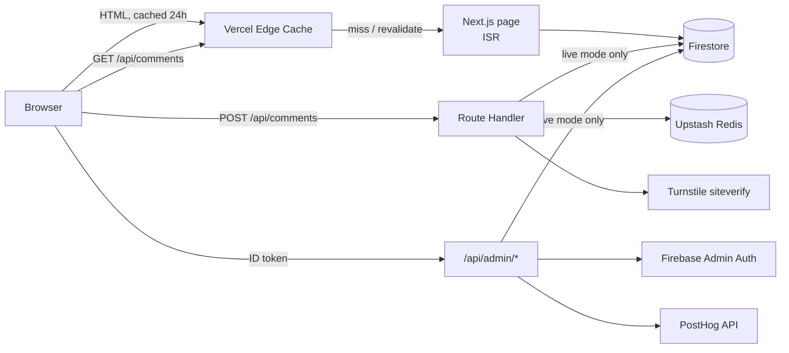
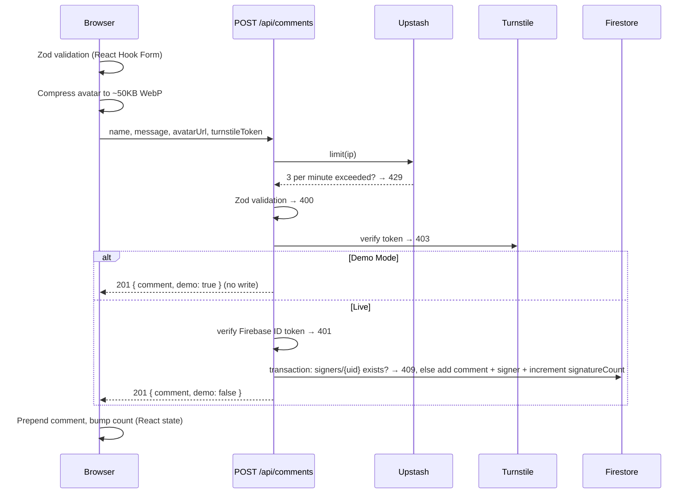

# Petition Platform

A generic, production-shaped petition engine built with **Next.js**, **Firebase** and **Vercel**. Visitors can sign with a comment and an optional avatar, share the campaign, and page through other signers. A hidden admin dashboard shows traffic analytics and controls the goal and pinned comments.

The public deployment runs in **Demo Mode**: everything works in the browser, but nothing is written to the database. It is read-heavy, edge-cached and costs close to nothing to keep online.

> Demo admin login: `admin@demo.com` / `demo2026` at `/admin` (view-only)

---

## Features

- Server-rendered petition page with a progress bar, share links (WhatsApp, X, copy link) and generated Open Graph images
- Sign form with client and server validation, bot protection, rate limiting and in-browser avatar compression
- Comments paginated 10 at a time and cached client-side
- Admin dashboard with 7-day page views, visitors and top traffic sources from PostHog, plus goal and pin controls
- Demo Mode, which keeps the database at zero writes and the public admin view-only

## Stack

| Concern | Choice |
| --- | --- |
| UI | React 19, Tailwind CSS v4, Lucide icons |
| Framework and API | Next.js 15 App Router, Route Handlers |
| Hosting | Vercel (Edge cache + serverless functions) |
| Domain and TLS | Porkbun registrar, Cloudflare DNS with SSL/TLS **Full (strict)** |
| Database | Firebase Firestore |
| Auth | Firebase Auth: admin email/password; signers via email code + custom token (live mode) |
| Forms and validation | React Hook Form + Zod |
| Server state | TanStack Query |
| Bot protection | Cloudflare Turnstile |
| Rate limiting | `@upstash/ratelimit` on Upstash Redis |
| Analytics | PostHog (tracking + HogQL API for the dashboard) |
| Avatars | `browser-image-compression` → 64 px WebP stored inline on the comment (no file storage) |
| Dates | `date-fns` |
| Tests | Vitest, GitHub Actions |

## Architecture



All Firestore reads and writes go through the server with the Firebase Admin SDK. The Firestore rules deny every client write (`firestore.rules`), so validation, rate limiting and bot checks can't be bypassed by calling Firebase directly. There are no direct client writes: avatars are shrunk in the browser to a 64 px WebP data URL and sent with the signature; the server accepts only WebP/PNG/JPEG bytes up to 8 KB (`src/lib/tiny-avatar.ts`), so no Storage bucket or Blaze plan is needed.

### Data model

```
petitions/{petitionId}          title, description, goal, signatureCount
petitions/{petitionId}/comments name, message, avatarUrl, pinned, createdAt
```

Comments are ordered `pinned DESC, createdAt DESC` (composite index in `firestore.indexes.json`) and paginated with a document cursor.

### Signing a petition

Visitors sign in with their email and a 6-digit code first (`/api/auth/code`, `/api/auth/verify`; see [ADR 0003](docs/adr/0003-email-code-sign-in.md)). Codes are stored only as an HMAC for 10 minutes, allow 5 attempts and work once. "Send as Anonymous" is checked by default and replaces the name with "Anonymous" on the server. Signing is press-and-hold: the "Leaving Thumbprint" button fills a thumbprint over 1.2 s (mouse, touch, or holding Space/Enter) and cancels on early release, so a stray tap can't sign. Once signed, the form becomes a share card (OS share sheet, WhatsApp, X, copy link for Discord).



## Rate limiting

`POST /api/comments` uses a sliding window of **3 requests per IP per minute** (sign-in codes: 5 per IP per 10 minutes and 3 per email per 15 minutes; code checks: 10 per IP per 10 minutes; comment pages that miss the edge cache: 30 per IP per minute) (`src/lib/server/ratelimit.ts`), backed by Upstash Redis so the limit holds across every serverless instance and region. The check runs first, before parsing or calling Turnstile, so abusive clients cost one Redis call and nothing else. Over the limit, the API returns `429`.

It works in layers with the other defences:

1. **Zod** caps lengths and rejects blank, malformed or spammy input (several links, long repeated characters, all caps) on both client and server; a hidden honeypot field gets a fake success
2. **Turnstile** proves a human is submitting, which stops scripted mass signing
3. **Upstash** caps how fast any single IP can post
4. **Firestore rules** make the server the only writer

If the Upstash variables are unset, the limiter is a no-op. Set them for any public deployment.

## State management

Each kind of state lives in the tool built for it:

| State | Where | Why |
| --- | --- | --- |
| Petition and first page of comments | Server Components, rendered at build or revalidation | Fast first paint, no client fetch, cached at the edge |
| Further comment pages | TanStack Query keyed by cursor | Each page is fetched once, cached, and kept on screen while the next loads (`keepPreviousData`) |
| Sign form fields and errors | React Hook Form (uncontrolled inputs) | No re-render per keystroke; Zod schema shared with the API |
| Comments signed this session | `useState` in `PetitionBody` | Instant feedback, and in Demo Mode the only place they exist |
| Demo signer (email, signed) | `sessionStorage` via `useSigner` | Survives a reload in the tab, gone when it closes; never sent to Firestore |
| Admin session | Firebase Auth listener | Token refresh handled by the SDK; the server verifies every request |
| Toasts | `sonner` | Fire-and-forget UI feedback |

## Demo Mode

`NEXT_PUBLIC_DEMO_MODE` defaults to **on**. Only the exact value `false` enables writes.

- **Seeded data**: `npm run seed` writes five campaigns, one per public state, and 18 comments (skipped if comments already exist). The featured campaign has 8,452 signatures against a goal of 8,000, so it shows the Achieved badge and every milestone. Without Firebase credentials, the app serves the same seed data from memory, so a fresh clone works offline. The seed script refuses to run when `NEXT_PUBLIC_DEMO_MODE=false`.
- **Intercepted writes**: `POST /api/comments` runs the full pipeline (rate limit, validation, Turnstile) and returns a normal `201` but skips Firestore. The browser shows the comment from React state, and avatars are previewed locally and never uploaded.
- **Email sign-in without email**: the code request runs validation, Turnstile and rate limits, then returns the code to the screen in a "Demo Mode" notice instead of emailing it. No account is created. In live mode the code is emailed (Brevo, falling back to Resend, then Mailjet) and verify returns a Firebase custom token; `POST /api/comments` then requires the signer's ID token and allows one signature per account. Demo Mode has no server-side sign-in check: the sign-in gate is in the browser only, since nothing is written (ADR 0003).
- **Single-campaign mode** (the default for this alpha): `/` is the featured campaign, campaign links redirect home, and the admin list, edit form and metrics only cover that campaign. A deployment's owner can switch to multiple campaigns from a settings page only their account can see.
- **View-only admin**: the login screen prints the demo credentials. In the dashboard, the Max signatures input, Save and Pin show "Action disabled in Demo Mode." The admin write endpoints also return `403` in Demo Mode, so the UI is not the only guard.
- **Aggressive caching**: the petition page and OG image use `revalidate = 86400`, and `GET /api/comments` sends `s-maxage=86400`. Firestore is read about once a day, however many people visit.

See [ADR 0001](docs/adr/0001-demo-mode-and-edge-caching.md) for the reasoning.

## Getting started

```bash
nvm use            # Node 24
npm install
cp .env.example .env.local
npm run dev        # http://localhost:3000, seed data, Demo Mode
```

The app runs with an empty `.env.local`. Add services one at a time:

| Variables | Enables |
| --- | --- |
| `NEXT_PUBLIC_FIREBASE_*` | Real admin login via Firebase Auth, avatar uploads |
| `FIREBASE_PROJECT_ID`, `FIREBASE_CLIENT_EMAIL`, `FIREBASE_PRIVATE_KEY` | Firestore reads/writes, token verification, `npm run seed` |
| `ADMIN_EMAILS` | Who may use `/admin` (developer accounts are admins without being listed) |
| `NEXT_PUBLIC_TURNSTILE_SITE_KEY`, `TURNSTILE_SECRET_KEY` | Bot protection (`.env.example` has Cloudflare's test keys) |
| `UPSTASH_REDIS_REST_URL`, `UPSTASH_REDIS_REST_TOKEN` | Rate limiting |
| `NEXT_PUBLIC_POSTHOG_KEY`, `POSTHOG_PROJECT_ID`, `POSTHOG_PERSONAL_API_KEY` | Tracking and real dashboard stats |
| `NEXT_PUBLIC_SITE_URL` | Absolute URLs for Open Graph and share links |
| `OTP_HMAC_SECRET`, `SIGNER_ID_SECRET`, `EMAIL_FROM`, `BREVO_API_KEY` (+ optional `RESEND_API_KEY`, `MAILJET_API_KEY`/`MAILJET_SECRET_KEY`, `GMAIL_USER`/`GMAIL_APP_PASSWORD`) | Live-mode email codes with provider fallback |
| `NEXT_PUBLIC_GOOGLE_SIGNIN=true` | Live-mode "Continue with Google" for signers (unset: simulated in Demo Mode, off in live) |
| `PRIVACY_CONTROLLER_NAME`, `PRIVACY_CONTACT_EMAIL` | Who runs the petition and its contact email on `/privacy` (defaults: DAWN, `GMAIL_USER`) |
| `CSP_ENFORCE=true` | Enforce the full Content Security Policy instead of report-only |

### Firebase setup

1. Create a project and enable Firestore and Email/Password auth (no Storage needed).
2. Create the admin user (for the demo: `admin@demo.com` / `demo2026`) and add the email to `ADMIN_EMAILS`.
3. Deploy the rules and indexes: `firebase deploy --only firestore:rules,firestore:indexes`.
4. Create a service account key and copy its values into the `FIREBASE_*` server variables.
5. `npm run seed`.
6. Optional, Google sign-in for signers (ADR 0006): Authentication → Sign-in method → Add new provider → **Google** → Enable, pick a support email, Save. Then Authentication → Settings → **Authorized domains** → add the live domain (e.g. `your-app.vercel.app`; preview URLs need adding one by one, wildcards are not accepted). Set `NEXT_PUBLIC_GOOGLE_SIGNIN=true` and redeploy.

### Email codes without a domain

Brevo, Resend and Mailjet need a domain you control (SPF/DKIM). On a plain `*.vercel.app` deploy, send codes from a Gmail account instead; it is tried after the others, and `EMAIL_FROM` is not needed if Gmail is the only provider.

1. Use a dedicated Gmail account for the campaign, not a personal one. Turn on **2-Step Verification** (Google Account → Security).
2. Google Account → Security → **App passwords** → create one named after the site. Copy the 16 characters.
3. Set `GMAIL_USER` (the address) and `GMAIL_APP_PASSWORD` in Vercel (never in the repo) and redeploy.

Limits and risk: Google documents about **500 messages a day** for a regular Gmail account (we stop at 475); hitting it blocks sending for up to 24 hours. Google can suspend accounts that look like bulk senders, so keep it to sign-in codes, and prefer Google sign-in as the main button so most signers never need a code.

### Deploying

1. Import the repo into Vercel and add the environment variables.
2. Register the domain at Porkbun and change its nameservers to Cloudflare.
3. In Cloudflare, point the domain at Vercel and set SSL/TLS to **Full (strict)**.
4. Add the domain in Vercel.

## Scripts

| Command | Does |
| --- | --- |
| `npm run dev` | Development server |
| `npm run build` / `npm start` | Production build and server |
| `npm run lint` / `npm run typecheck` | ESLint / `tsc --noEmit` |
| `npm test` | Vitest |
| `npm run seed` | Seed Firestore from `src/data/seed.ts` |
| `npm run developer -- you@example.com` | Create or reset a developer account: random password printed once, `developer` custom claim |

CI (`.github/workflows/check.yml`) runs lint, typecheck, tests and build on every pull request.

## Project structure

```
src/
  app/
    page.tsx                 Petition page (ISR 24h, metadata)
    opengraph-image.tsx      Generated share image
    admin/page.tsx           Admin login and dashboard
    api/comments/            GET (paged, edge-cached) and POST (sign)
    api/admin/               stats, petition goal, comment pin
  components/                UI, plus admin/ for the dashboard
  data/seed.ts               Demo petition and comments
  lib/
    schemas.ts               Zod schemas shared by client and server
    petition.ts              Firestore reads with seed fallback
    firebase/                Client and Admin SDK setup
    server/                  Rate limit, Turnstile, admin and signer auth, email codes, PostHog
scripts/seed.ts
firestore.rules, firestore.indexes.json
```

## License

MIT
